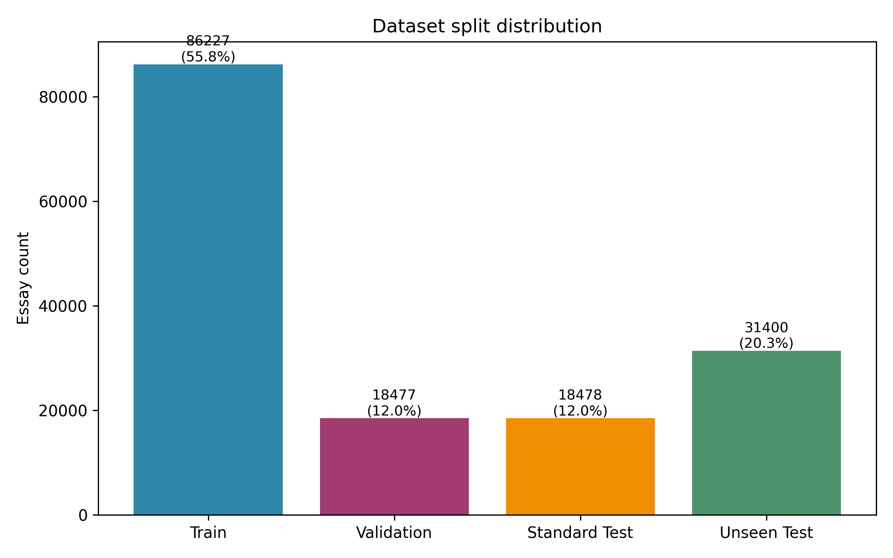
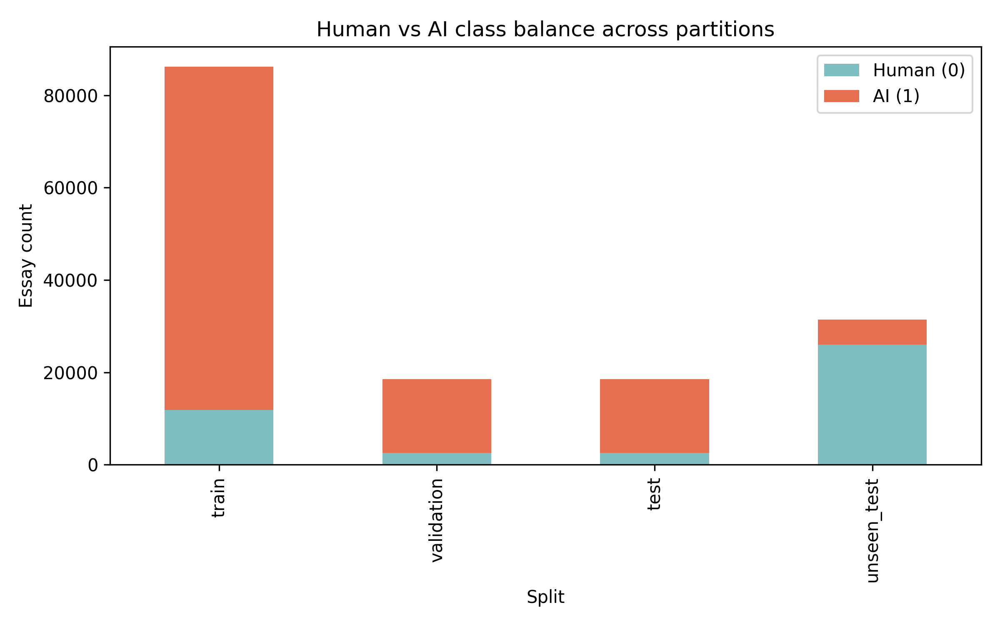
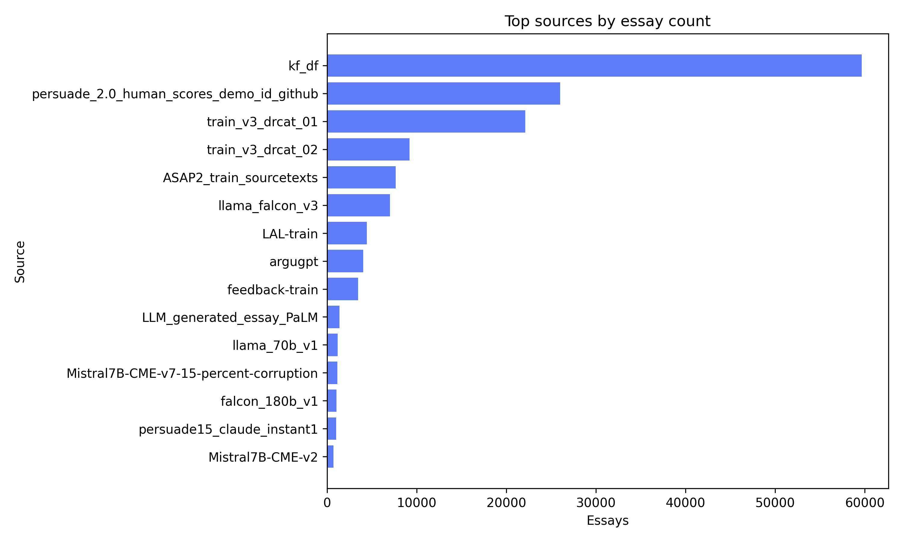
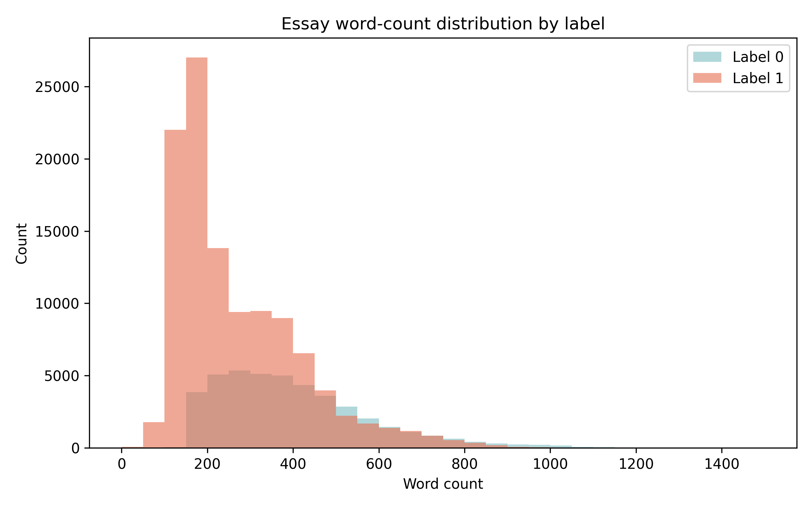
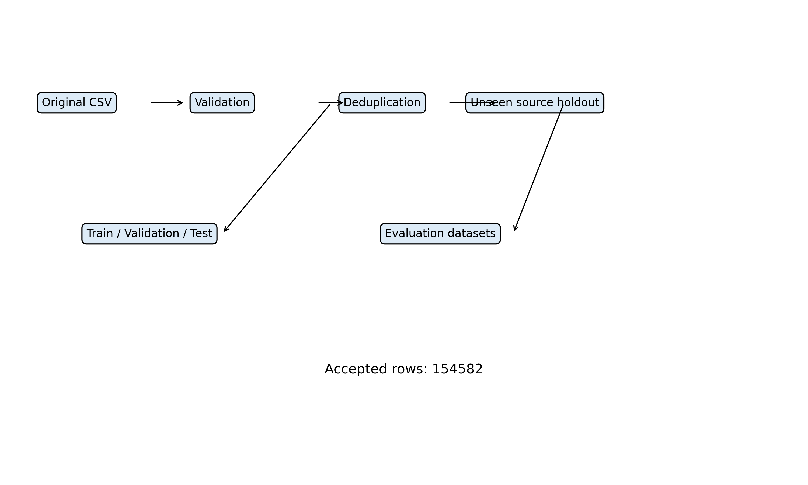
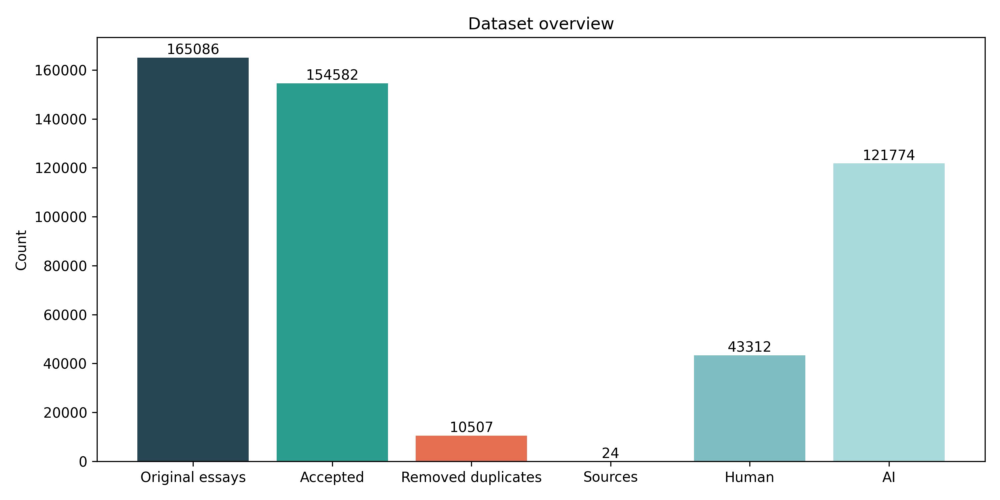

# Dataset directory

This folder contains the processed CS747 dataset, metadata manifests, generated visualizations, and dataset documentation.

## Current dataset summary

- Original records: 165086
- Accepted records after validation and deduplication: 154582
- Removed records: 10504
- Sources retained: 24
- Human-written essays: 43312
- AI-generated essays: 121774

## Data-quality findings

- Missing or empty text rows: 4
- Exact duplicate rows: 0
- Normalized duplicate rows: 10501
- Conflicting-label records quarantined: 2
- Dataset hash: `e6f09bceef8d6bd2334034ebcd0cc85f388e116f5abe9d9983d4037f6b611982`

## Standard experimental split

The accepted dataset is partitioned into train, validation, and standard test as 70/15/15 using seed 747.

- Train: 86227
- Validation: 18477
- Test: 18478
- Unseen test: 31400

## Unseen-source evaluation strategy

The unseen test set is created by holding out explicitly identified source families and a human source to test distribution shift: Mistral7B-CME-v1, Mistral7B-CME-v2, Mistral7B-CME-v3, Mistral7B-CME-v4, Mistral7B-CME-v5, Mistral7B-CME-v6, Mistral7B-CME-v7, Mistral7B-CME-v7-15-percent-corruption, persuade_2.0_human_scores_demo_id_github.

## Figure references

## Key files

- `processed/train.csv`
- `processed/validation.csv`
- `processed/test.csv`
- `processed/unseen_test.csv`
- `manifests/data_quality_report.json`
- `manifests/split_manifest.json`
- `manifests/unseen_test_manifest.json`
- `figures/*.png`
