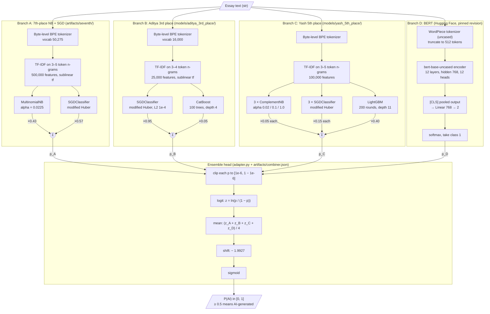

# Custom model architecture

**Byte-level BPE TF-IDF branches (×3) + BERT-base branch → log-odds mean ensemble → threshold-shifted sigmoid**

The custom model is one detector with four parallel branches. Each branch reads the raw essay and outputs P(AI). The
ensemble head merges the four outputs into one final P(AI). Every branch was fit on the frozen `train.csv`.



## Output

```
P(AI) = sigmoid( (logit p_A + logit p_B + logit p_C + logit p_D) / 4 − 1.9927 )
```

`predict_proba(texts)` returns a NumPy float vector of shape `(n_texts,)`, where 1 means AI-generated.

## Layers

| Stage | Branch A: 7th place | Branch B: Aditya | Branch C: Yash | Branch D: BERT |
|---|---|---|---|---|
| Tokenizer | Byte-level BPE, 50,275 tokens | Byte-level BPE, 16,000 tokens, NFC | Byte-level BPE | WordPiece, uncased, max 512 |
| Features | TF-IDF 3–5-grams, 500k, sublinear | TF-IDF 3–4-grams, 25k, sublinear | TF-IDF 3–5-grams, 100k | 12 transformer layers, 768-d `[CLS]` |
| Classifiers | MultinomialNB + SGD | SGD + CatBoost | 3 ComplementNB + 3 SGD + LightGBM | Linear 768 → 2 |
| Branch merge | Weighted mean of P, 0.43 / 0.57 | Weighted mean of P, 0.95 / 0.05 | Weighted mean of P, 0.05×3 / 0.15×3 / 0.40 | Softmax |
| Output | p_A | p_B | p_C | p_D |

| Ensemble head | Value |
|---|---|
| Clip | 1e-6 |
| Combination | Equal mean of logits (weight 0.25 per branch, bias 0) |
| Threshold shift | `threshold_logit` = 1.9927, chosen for the best balanced accuracy on validation |
| Final activation | Sigmoid |

## Design notes

- **Two kinds of signal:** branches A–C measure surface n-gram statistics of subword tokens, and branch D measures
  contextual style. Their errors differ, so the mean is more stable across benchmarks than any one branch.
- **Mean in log-odds space:** a confident branch moves the result more than one near 0.5. The clip keeps every
  logit finite, so no single branch can force the output to 0 or 1.
- **Equal weights:** the equal mean beat logistic regression on logits in source-held-out validation, so the head has
  no fitted weights to overfit.
- **Zero-weight branches** in `combiner.json` are not loaded at all.

## Size and runtime

| Component | Stored size | Where |
|---|---|---|
| Branch A | about 19 MB | `models/custom_model/artifacts/seventh/` (in git) |
| Branch B | about 2.4 MB | `models/aditya_3rd_place/artifacts/` (in git) |
| Branch C | see that package | `models/yash_5th_place/artifacts/` (in git) |
| Branch D | about 420 MB, about 110M parameters | `JaCkKnite12/cs747-custom-bert`, revision `2710a1b`; downloaded on first use |
| Head | 2 KB | `models/custom_model/artifacts/combiner.json` |

Branches A–C run on CPU. Branch D runs on GPU when one is available; on CPU it is the slowest branch.
